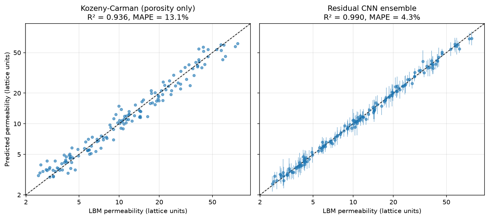
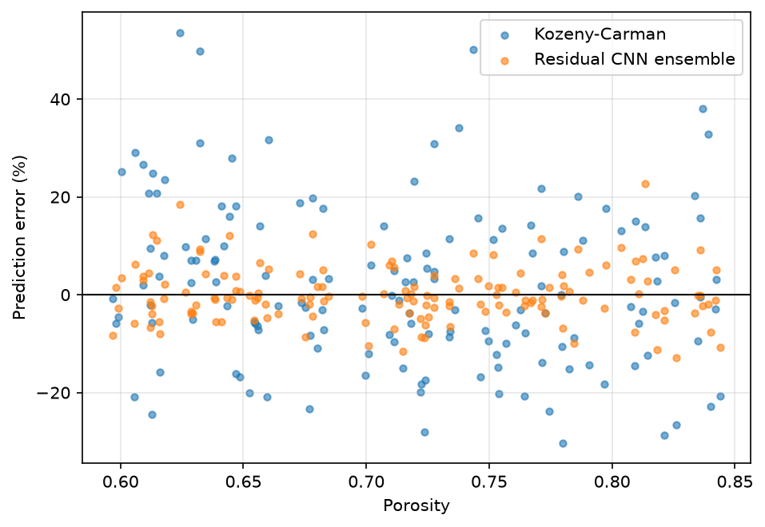
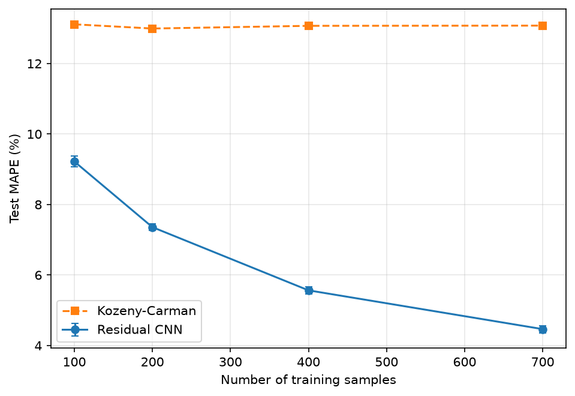
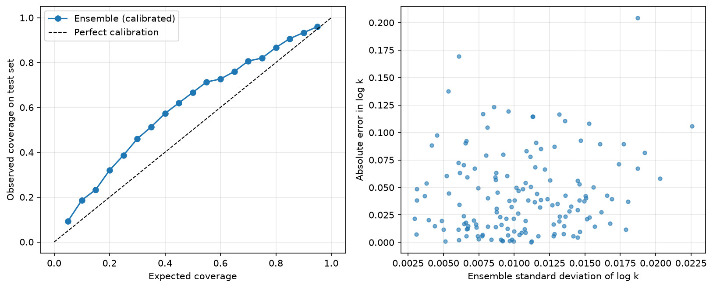
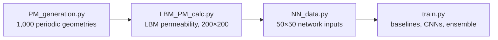
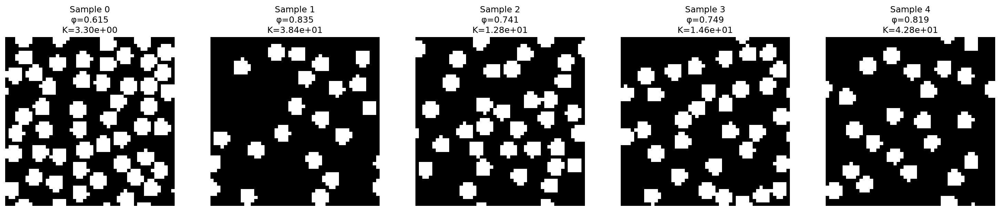

# Physics-informed surrogates for porous media permeability

Lattice Boltzmann (LBM) simulations give accurate permeabilities for flow through porous media, but each one takes seconds to minutes, which is too slow inside a design or optimisation loop. This project builds a validated LBM solver in JAX, uses it to label 1,000 synthetic porous geometries, and trains neural network surrogates that predict permeability from the pore geometry in milliseconds.

The main finding is that porosity alone explains about 96% of the variation in log permeability, so a two-parameter Kozeny-Carman fit is already a strong baseline. A CNN that learns only the correction to that baseline, with augmentation based on the physical symmetries of the problem, reduces the test error to about a third of the baseline's.

<p align="center"></p>

## Results

All models are evaluated on the same 150 held-out test geometries, which are never used for training, early stopping or calibration. CNN results are the mean and standard deviation over 5 random seeds, and the ensemble row averages the 5 models.

| Model | Test R² | MAPE | RMSE |
|---|---|---|---|
| Kozeny-Carman (porosity only) | 0.936 | 13.1% | 4.03 |
| CNN on log k, augmented | 0.974 ± 0.005 | 7.1 ± 0.8% | 2.55 |
| Residual CNN, not augmented | 0.963 ± 0.004 | 8.7 ± 0.3% | 3.04 |
| Residual CNN, augmented | 0.990 ± 0.000 | 4.4 ± 0.1% | 1.60 |
| **Residual CNN, augmented, 5-model ensemble** | **0.990** | **4.3%** | **1.59** |

RMSE is in lattice units of permeability. Comparing the rows shows what each design choice contributes:

- **Symmetry augmentation is the largest single gain.** Permeability in the flow direction does not change under periodic shifts or flips along either axis, so each geometry can be presented in many equivalent forms during training. This halves the residual CNN's error (8.7% to 4.4%).
- **Learning the residual helps once the model generalises.** With augmentation, predicting the correction to Kozeny-Carman beats predicting log k directly (4.4% vs 7.1%).
- **The CNN learns structure that porosity cannot capture.** The error against porosity plot shows the residual CNN removes most of the large Kozeny-Carman errors, which come from geometries whose pore arrangement makes them much more or less permeable than their porosity suggests.

<p align="center"></p>

### How much data is needed

<p align="center"></p>

Test error falls steadily from 9.2% with 100 training samples to 4.5% with 700, and has not levelled off, so more simulations would improve the surrogate further. Kozeny-Carman stays at about 13% regardless of dataset size because two parameters cannot use more data.

### Uncertainty

<p align="center"></p>

The predictive uncertainty combines the spread of the ensemble with a noise term, σ² = a·σ²<sub>ensemble</sub> + b, with a and b fitted by maximum likelihood on the validation set. On the test set, 95% intervals contain 96% of the true values, compared with 33% using the raw ensemble spread.

On its own, the ensemble spread is far too narrow, so calibration scales it up by a factor of about 6.7 and adds a small noise floor. The resulting intervals are reliable on average and their width varies from geometry to geometry, but the ensemble spread is only weakly related to the actual error (rank correlation 0.12), so a wide interval does not reliably flag the predictions most likely to be wrong.

## Pipeline



**Geometry.** Each sample is a periodic unit square filled with non-overlapping circular grains of radius 0.05, placed by random sequential addition until a target porosity between 0.6 and 0.85 is reached. Each geometry is stored with its random seed so it can be regenerated exactly.

<p align="center"></p>

**Solver.** D2Q9 lattice Boltzmann with a multiple-relaxation-time collision operator, written in JAX and JIT-compiled, in 64-bit precision. Flow is driven by a uniform body force using Guo forcing applied in moment space, with halfway bounce-back on solid surfaces and periodic boundaries in both directions. The relaxation rate of the energy flux moments is linked to the viscosity through the "magic" parameter Λ = 3/16, which places the bounce-back wall exactly halfway between nodes and makes the permeability independent of viscosity. Each geometry runs on a 200×200 lattice until the superficial velocity changes by less than 0.01% over 500 steps (2,000 to 19,500 steps), and permeability follows from Darcy's law.

**Surrogates.** Geometries are rasterised at 50×50 for the networks. The CNN uses circular padding so that it treats opposite edges of the periodic domain as neighbours, three convolutional blocks with batch normalisation, and global average and max pooling. It is trained with AdamW on standardised log permeability (or its residual from Kozeny-Carman), with early stopping on a separate validation set, and test-time averaging over the four flips of each geometry.

## Solver validation

`validation.py` compares the solver against two analytical results.

| Case | LBM k | Analytical k | Error |
|---|---|---|---|
| Channel flow, 20 cells wide, at ν = 0.01, 0.05 and 1/6 | 22.250 | 22.222 | +0.12% |
| Channel flow, 8 cells wide, at ν = 0.01, 0.05 and 1/6 | 3.583 | 3.556 | +0.78% |
| Square array of cylinders, solid fraction 0.03 | 804.7 | 811.6 | -0.85% |
| Square array of cylinders, solid fraction 0.13 | 325.9 | 328.1 | -0.67% |

Channel flow is compared with the exact Poiseuille solution, and the cylinder arrays with the series solution of Sangani and Acrivos (1982), using the rasterised cylinder area. The channel permeability is identical at all three viscosities, which confirms it does not depend on the numerical viscosity, and the remaining channel error is exactly 1/(2h²), the error from summing the velocity at discrete nodes across a channel h cells wide. The cylinder error comes from representing a circle on a square grid.

## Running

Requires [uv](https://docs.astral.sh/uv/).

```bash
uv sync
uv run python PM_generation.py           # 1,000 geometries in pm_data/
uv run python LBM_PM_calc.py             # permeabilities, resumes if interrupted
uv run python NN_data.py                 # nn_dataset.npz
uv run python train.py --learning-curve  # results/metrics.json and figures/
uv run python validation.py              # solver checks, results/validation.json
```

`LBM_PM_calc.py 10` runs only the first 10 geometries, which is useful for a timing test. `train.py --quick` trains short versions of every model to check the setup.

| File | Purpose |
|---|---|
| `PM_generation.py` | Generates the porous geometries |
| `LBM_PM_calc.py` | Lattice Boltzmann solver and permeability calculation |
| `NN_data.py` | Rasterises geometries and builds the network dataset |
| `train.py` | Kozeny-Carman baseline, CNN variants, ensemble uncertainty and learning curve |
| `validation.py` | Solver checks against analytical solutions |
| `ANN_implementation.py`, `CNN_implementation_without_porosity.py`, `CNN_implementation.py` | Fully connected, 1D CNN and 2D CNN models from the original study |

## Limitations and next steps

- The geometries are 2D with identical circular grains. Real porous media are 3D, with a range of grain sizes and shapes.
- The 50×50 network input under-resolves the narrowest pore throats. Higher resolution inputs, or predicting the full velocity field, are natural next steps.
- The ensemble spread is not informative about individual errors. Heteroscedastic outputs or Bayesian neural networks could give uncertainty that varies more meaningfully between geometries.
- The learning curve suggests that a larger dataset would continue to reduce the error.

## Background

This started as a Chemical Engineering Study Project at the University of Edinburgh (January 2026), supervised by Prof. Timm Krüger. The solver, dataset and models were revised in November 2026. Validating the solver against the analytical permeability, rather than a normalised velocity profile, showed that the original forcing and bounce-back implementation under-predicted permeability by about 45%. The revision corrected the solver, widened the porosity range to what the geometry generator can actually reach, separated the validation and test sets, and added the baseline, residual learning, augmentation and uncertainty analysis above.
